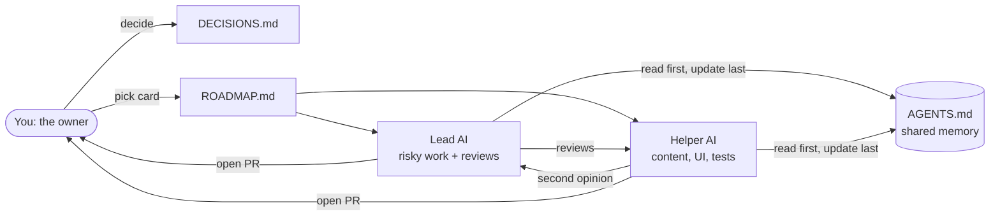
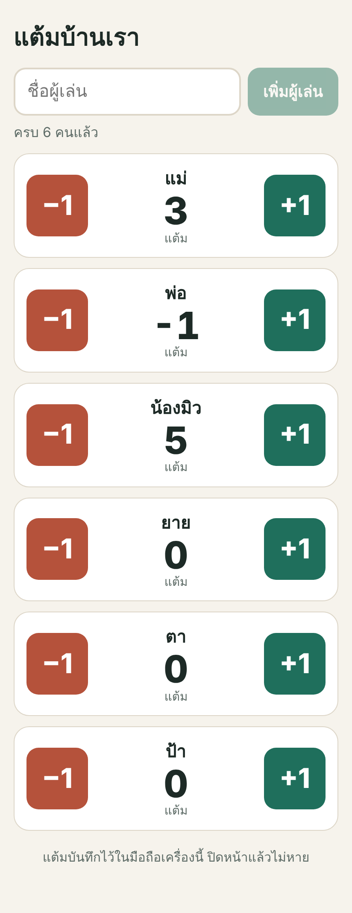

# AI Crew Kit

**Run a real software project with a team of AIs — even if you can't code.**

[ภาษาไทย](README.th.md) · [Start here](START-HERE.md) · [Case study: a full MMORPG server](examples/harvestia.md)

AI coding tools are powerful, but when you can't read the code yourself, things go wrong in quiet ways:

- 🧠 **It forgets.** New chat, and you explain the whole project again.
- 🎲 **It guesses.** It "decides" prices, deletes data, or changes something you already decided.
- 💥 **Two AIs collide.** One undoes the other's work.
- ✅ **"Done!"** …but nobody actually tested it.

AI Crew Kit is a set of plain-text files and copy-paste prompts that turn your AIs into a small, disciplined team —
with a shared memory, a work board, a list of things they must always ask you about, and a habit of reviewing each other.

No install. No code. Works with Claude Code, Codex, Cursor, GitHub Copilot, Gemini CLI — anything that reads files.

---

## How it works



| File | What it does for you |
|---|---|
| `AGENTS.md` | **Shared memory.** Every AI reads it first and updates the Status at the end. No more re-explaining. |
| 🔴 Red Zone (in `AGENTS.md`) | Money, deleting, security, going live, spending — the AI **must stop and ask you**. |
| `docs/ROADMAP.md` | **Work cards.** One small thing at a time, each with "Done when…" you can check yourself. |
| `docs/DECISIONS.md` | **Your decisions, in your words.** The AI can't quietly "re-decide". Newest wins. |
| `docs/adr/` | Big locked decisions (stack, money rules) — changing them needs your approval. |
| `docs/BACKLOG.md` | Where AI ideas go **instead of** being built behind your back. |
| `docs/HANDOFF.md` | Switch AI or take a week off without losing the thread. |
| `PROMPTS.md` | Copy-paste prompts: start, do a card, review a PR, "is it REALLY done?", explain it to me, close the session. |

### The rules that matter most
1. **One card at a time.** One card = one branch = one pull request.
2. **"Done" means verified** — every AI must list ✅ what it checked and ⚠️ what it did *not* try for real.
3. **The other AI reviews.** The Lead reviews every Helper PR. You merge.
4. **Fail safe with value.** If something with money/credits/stock can fail halfway, "got nothing, refund it" beats "got it twice".
5. **Out-of-scope ideas go to the backlog**, not into the code.

---

## Quick start (3 minutes)

1. Open your AI coding tool in your project folder (new or existing).
2. Paste the prompt from **[START-HERE.md](START-HERE.md)**.
3. Answer its questions (one at a time, plain language). It fills in everything and proposes your first cards.

Then every day: **Prompt #1** (start) → **#3** (do a card) → **#4** (other AI reviews) → you merge → **#8** (close).

Prefer to copy files yourself? Click **Use this template**, or into a new empty folder:
```bash
npx degit minjuhehe/ai-crew-kit/template my-project
```

---

## See it in action



**[Example: a family scoreboard](examples/family-score/)** — a non-coder answers 6 questions in Thai, and the AI sets up the project, proposes the cards, builds the first one, and checks it on a phone-sized screen. Every file it wrote is in that folder.

<br clear="right">

## Built from a real project

This kit was extracted from **[Harvestia](examples/harvestia.md)** — a Thai Minecraft MMORPG server
(classes, levels, bosses, quests, weapon upgrades, guilds, a web store with payments) built by an owner who does not write code,
using Claude as Lead and a second AI as Helper.

In the first weeks: **~170 commits · ~37,000 lines of Java · 17 spec files · 18 locked decisions (ADRs) · 100+ owner decisions logged.**

[Read what worked, and what we'd do differently →](examples/harvestia.md)

---

## FAQ

**Do I need two AIs?** No. One AI works fine — just give it both roles. A second AI mainly adds a fresh pair of eyes for reviews.

**Which AI should be Lead?** The one you trust most with careful, risky work. The Lead does money, data and security, and reviews everything.

**Why is AGENTS.md in English if I talk Thai/Spanish/…?** So every AI reads the rules the same way. The AIs still talk to *you* in your language.

**My project already has code.** Fine — the setup prompt reads it and fills the stack in for you. It never overwrites your files without asking.

**Is this only for games?** No. Nothing in the template is game-specific: web apps, bots, shops, internal tools.

## Contributing
Found a rule or prompt that saved your project? Open an issue or PR with the story — real stories beat theory.

## License
[MIT](LICENSE)
