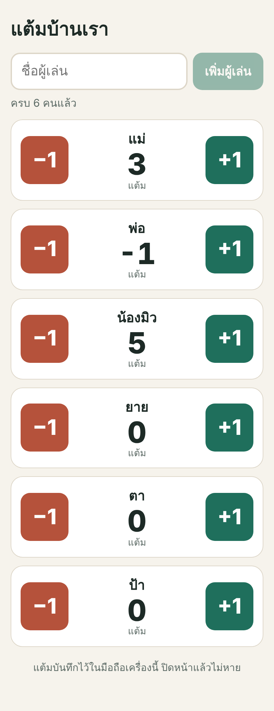

# Example: "แต้มบ้านเรา" — a family board-game scoreboard

A real test run of the kit, start to finish: an owner who can't code, answering in Thai, on a Windows PC + Android phone, with a budget of 0.
Everything in this folder was written by the AI from the setup prompt in [START-HERE.md](../../START-HERE.md) and prompt #3 ("Do a card").

## What the owner typed
| Question | Owner's answer |
|---|---|
| What are you building? | "เว็บหน้าเดียวไว้จดแต้มบอร์ดเกมในครอบครัว เล่นบนมือถือ คนในบ้าน 2-6 คน" |
| 3 things never to sacrifice | "1 ใช้บนมือถือง่าย ปุ่มใหญ่ 2 ไม่ต้องสมัคร 3 ปิดหน้าแล้วแต้มไม่หาย" |
| Language | "ภาษาไทย" |
| Can you code? | "ไม่เป็นเลย" |
| Which AIs? | "Claude เป็นตัวหลัก GPT เป็นผู้ช่วย" |
| Budget / device | "งบ 0 บาท ใช้ Windows กับมือถือ Android" |

## What the AI asked back (stack, in Thai)
> แนะนำ: เว็บหน้าเดียว (HTML) เปิดในเบราว์เซอร์มือถือได้เลย แต้มเก็บในมือถือเครื่องนั้น ปิดหน้าแล้วแต้มไม่หาย ไม่ต้องสมัคร ไม่ต้องมีเซิร์ฟเวอร์ ค่าใช้จ่าย 0 บาท …
> อีกทางเลือก: เว็บ + ฐานข้อมูลออนไลน์ฟรี (Firebase) ดูแต้มได้จากหลายเครื่อง แต่ต้องดูแลบัญชีและเรื่องความปลอดภัยเพิ่ม ตอนนี้ยังไม่จำเป็น

Then it proposed 7 cards (scoreboard → new game → +5/+10 → highlight the leader → put it online (Red Zone: asks first) → undo → edit players), built card P0.1, and checked it itself in a phone-sized headless browser:
add players → tap scores → reload → close and reopen → scores still there.

Its final report listed honestly what it had **not** tried: a real Android phone, private mode, and a second-AI review.

## What we changed in the kit after this run
The run found 12 rough edges (e.g. nobody asked for the project name, the git setup assumed GitHub, rules were heavy for a one-file app).
They're fixed in the current template — so this folder was made with the *previous* version and looks slightly different from what you'll get.
